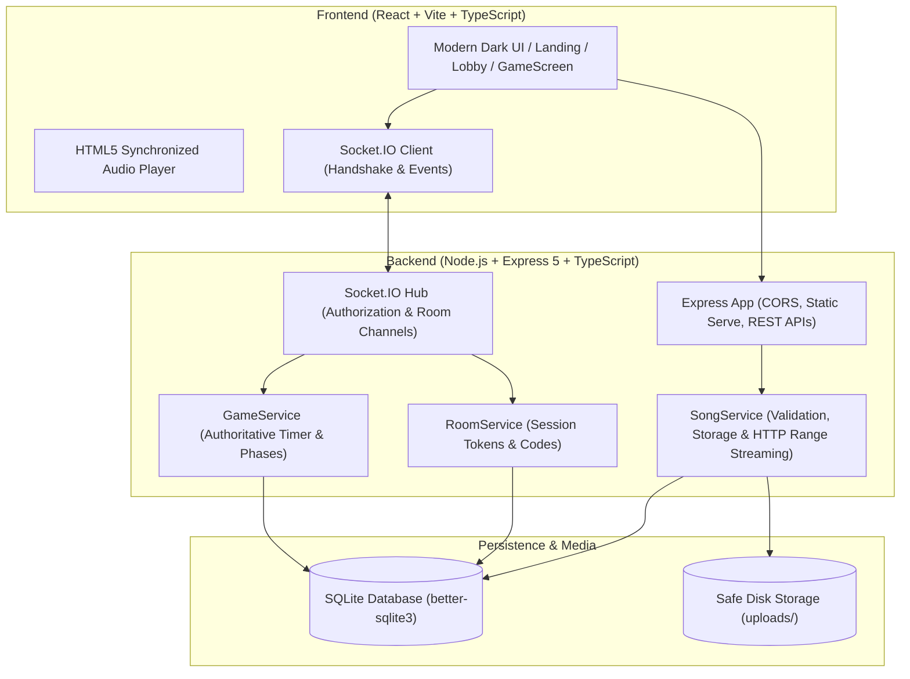

# 🎵 Who Added This Song? — Multiplayer Music Party Game

A real-time multiplayer music party game web application where friends join private rooms, select tracks from Jamendo or upload audio files, listen together synchronously, discuss, vote on whose song it is or guess the title/artist, earn points, and compete on a live leaderboard.

---

## 1. Supported Music Sources & Playback Methods

This application supports three flexible music sources:

1. **YouTube Song Search & Official Playback** — Players search YouTube titles and artists directly within the game via a server-side `POST /api/search` proxy powered by `yt-search`. Selected songs are queued and played in a compact 200 × 150 px fixed-corner player powered by the official YouTube IFrame Player API.
2. **Jamendo Catalog Search** — Players search and stream licensed Creative Commons music directly from Jamendo's official catalog.
3. **Manual Audio Upload** — Players upload audio files from their own devices (MP3, WAV, OGG, M4A, AAC up to 20 MB).

> [!NOTE]
> **Playback Restrictions & YouTube Compliance:**
> YouTube playback strictly adheres to official YouTube IFrame Player API guidelines. Audio is never extracted, downloaded, or converted. The 200 × 150 px player remains visible, unhidden, and unobstructed with all controls accessible. Autoplay blocking is managed via a manual "Enable Playback" interaction when necessary. Round progression remains strictly server-authoritative and never depends on client-side player events.

### Jamendo API Setup:
To enable in-game Jamendo catalog search:
1. Register for a free application Client ID on the [Jamendo Developer Portal](https://developer.jamendo.com).
2. Create a `.env` file in the project root (see `.env.example`).
3. Set your Client ID:
   ```env
   JAMENDO_CLIENT_ID=your_client_id_here
   ```
4. If `JAMENDO_CLIENT_ID` is omitted, the game remains fully functional via the **Upload From Device** tab.

---

## 2. Architecture Overview

The application is built with a single unified backend that serves both the static production React frontend, real-time WebSocket communication, and RESTful audio upload and streaming APIs.



### Key Technical Characteristics:
- **Server-Authoritative State:** Clients never calculate scores, decide timeouts, advance rounds, or dictate who the song uploader is. All phase transitions, timers, and scoring transactions take place strictly on the server.
- **Privacy & Secret Protection:** The server redacts the song uploader's identity during the *Playing*, *Discussing*, and *Voting* phases. Only in the *Reveal* phase or privately to the uploader (`is_my_song: true`) is the uploader known.
- **Audio Synchronization:** The server assigns a coordinated start timestamp (`playback_start_time = Date.now() + 2000`). Connected clients lock to this timestamp with continuous drift correction (`drift > 0.6s`), ensuring everyone hears the same section simultaneously.
- **Session Credentials & Anti-Impersonation:** Guest nicknames are paired with cryptographic server-generated session tokens (`UUIDv4`). Clients cannot forge another player's actions or take over host roles by changing client-side identifiers. Disconnected players can re-join their session upon page refresh without losing progress.
- **Atomic Scoring:** Database transactions via `better-sqlite3` ensure that round results are awarded exactly once (+1 pt for correct guess, 0 for incorrect), guarding against double-scoring on network reconnects.

---

## 2. Requirements & Node.js Version

- **Node.js:** v20.x, v22.x, or v24.x (Tested with Node.js v24.22.0)
- **NPM:** v10.x or v11.x (Tested with npm 11.19.1)
- **Operating System:** Windows 10/11, macOS, or Linux.

---

## 3. Project Structure

```
music-party-game/
├── package.json               # Root scripts, server dependencies, and Vitest runner
├── tsconfig.json              # TypeScript configuration for server & tests
├── vitest.config.ts           # Vitest configuration
├── database.sqlite            # SQLite database file (auto-created on startup)
├── uploads/                   # Audio storage folder with safe UUID filenames
├── .env.example               # Example environment configuration
├── README.md                  # Comprehensive setup and documentation
│
├── server/
│   ├── src/
│   │   ├── app.ts             # Express app setup, CORS, static frontend serve
│   │   ├── config.ts          # Central configuration constants
│   │   ├── index.ts           # HTTP server, Socket.IO initialization, app entry
│   │   ├── db/
│   │   │   ├── database.ts    # better-sqlite3 connection and schema setup
│   │   │   └── repositories/
│   │   │       ├── roomRepo.ts   # Room queries and updates
│   │   │       ├── playerRepo.ts # Player sessions, readiness, and scores
│   │   │       ├── songRepo.ts   # Song metadata and played state
│   │   │       └── gameRepo.ts   # Rounds, votes, scoring transactions, chat
│   │   ├── services/
│   │   │   ├── roomService.ts # Room codes, guest auth, host permissions
│   │   │   ├── songService.ts # File validation, path safety, secure stream
│   │   │   └── gameService.ts # Authoritative game loop, shuffle, timers, scoring
│   │   ├── routes/
│   │   │   ├── roomRoutes.ts  # Room creation, joining, session validation
│   │   │   └── audioRoutes.ts # Audio upload, delete, HTTP Range audio streaming
│   │   ├── socket/
│   │   │   └── socketHandler.ts # Real-time Socket.IO room events & chat
│   │   └── types/
│   │       └── index.ts       # Shared TypeScript interfaces & payload models
│   └── tests/
│       ├── setup.ts           # In-memory test context helper
│       ├── room.test.ts       # Room creation, 10-player limit, host rights
│       ├── upload.test.ts     # Format, size, traversal protection, streaming auth
│       ├── game.test.ts       # Min 3 players, song count, uploader voting exclusion
│       ├── scoring.test.ts    # Idempotent scoring transactions & tie handling
│       ├── reconnection.test.ts # Session token authentication recovery
│       └── e2e.test.ts        # REST API, static files, and Socket.IO integration
│
└── client/
    ├── package.json           # Frontend dependencies (React, Lucide, Confetti)
    ├── vite.config.ts         # Vite bundler config with API/WebSocket proxying
    ├── index.html             # HTML5 app entry point with metadata
    └── src/
        ├── App.tsx            # Screen router and reconnection banners
        ├── index.css          # Premium dark theme, visualizers, animations
        ├── main.tsx           # React DOM root entry
        ├── types/             # Frontend TypeScript types
        ├── utils/
            ├── audioUnlock.ts # Browser audio policy unlock helper
            └── session.ts     # Browser session storage persistence
        ├── context/
            └── GameContext.tsx# Centralized Socket and Game state React context
        └── components/
            ├── Navbar.tsx         # Header with status & audio enable button
            ├── Landing.tsx        # Hero section, rules, Create/Join actions
            ├── CreateRoom.tsx     # Nickname, rounds (3-20), discussion duration
            ├── JoinRoom.tsx       # 6-character room code input
            ├── Lobby.tsx          # Players, readiness, uploads, host controls
            ├── GameScreen.tsx     # Active game orchestrator & live scores
            ├── AudioPlayer.tsx    # Synchronized player with drift correction
            ├── VotingControls.tsx # Private voting cards & uploader exclusion notice
            ├── RoundResults.tsx   # Reveal ceremony, points earned, vote audit
            ├── FinalResults.tsx   # Final champion podium, ties, confetti
            └── ChatDrawer.tsx     # Floating in-game discussion chat panel
```

---

## 4. Installation and Startup Commands (Windows)

Because Windows PowerShell script execution policy may restrict `.ps1` files, use `npm.cmd` when invoking commands directly in PowerShell.

### Step 1: Install Dependencies
Open PowerShell in the `music-party-game` directory:
```powershell
cd C:\Users\pintu\music-party-game

# Install root & backend dependencies
npm.cmd install

# Install frontend dependencies
cd client
npm.cmd install
cd ..
```

### Step 2: Build the Frontend
```powershell
npm.cmd run build
```
This builds the production React application into `client/dist/`.

### Step 3: Run the Server
```powershell
npm.cmd start
```
The server will start listening at:
👉 **`http://localhost:3001`**

---

## 5. Running in Development Mode

If you wish to edit the frontend with Hot Module Replacement (HMR) and the backend with auto-reload:

Terminal 1 (Backend Watcher):
```powershell
cd C:\Users\pintu\music-party-game
npm.cmd run dev:server
```

Terminal 2 (Frontend Vite Dev Server):
```powershell
cd C:\Users\pintu\music-party-game\client
npm.cmd run dev
```
Open **`http://localhost:5173`** (Vite automatically proxies API and WebSocket requests to `localhost:3001`).

---

## 6. Running the Automated Test Suite

Run the complete test suite with Vitest:
```powershell
cd C:\Users\pintu\music-party-game
npm.cmd test
```

### Tests Covered:
1. **Room & Player Management (`room.test.ts`)**:
   - 6-character room code generation.
   - 10-player room maximum limit enforcement.
   - Host-only settings controls.
   - Rejection of joining closed/playing games.
2. **Audio Upload & Storage Security (`upload.test.ts`)**:
   - Validation of supported audio formats (MP3, WAV, OGG, M4A, AAC) and rejection of invalid extensions / MIME types.
   - 20 MB file size limit enforcement.
   - Prevention of path traversal and generation of unique safe filenames.
   - Maximum 3 songs per player enforcement.
   - Rejection of unauthorized audio streaming from non-members.
3. **Authoritative Game Rules & Round Flow (`game.test.ts`)**:
   - Requirement of at least 3 players before starting.
   - Rejection of starting when songs uploaded < rounds selected (with exact missing count).
   - Redaction of uploader identity during active play.
   - Strict exclusion of uploader from voting on their own song.
   - 1 vote per eligible player (rejecting duplicate or modified votes).
   - Early reveal when all eligible players have voted.
4. **Scoring & Leaderboard Engine (`scoring.test.ts`)**:
   - +1 point for correct uploader identification, 0 points for incorrect guesses.
   - Database transaction idempotency (no duplicate points awarded if repeated).
   - Tie handling on final podium and rankings.
5. **Session Resilience (`reconnection.test.ts`)**:
   - Disconnected player state detection.
   - Reconnection with session tokens without identity spoofing.
   - Rejection of forged session tokens.
6. **E2E Integration (`e2e.test.ts`)**:
   - REST API room creation, joining, file upload, and HTTP Range streaming.
   - Socket.IO handshakes, channel broadcast, and state synchronization.
   - Static client file delivery on root path.
7. **Second Game Mode: Guess the Song (`guess_mode.test.ts`)**:
   - Text guess normalization (casing, punctuation, whitespace).
   - Point scoring: +2 for title, +1 for artist.
   - Prevention of uploader guessing own song.
8. **5-Minute Timers & Skip Mechanics (`discussion_voting_skips.test.ts`)**:
   - Default 05:00 countdowns for discussion and voting.
   - Consensus-based discussion skip button with cancellation support.
   - Skip voting button recording abstentions (+0 pts).
   - Automatic early reveal upon completion of all eligible votes/skips.
   - Graceful handling of disconnected players.
9. **Jamendo Music Search & Manual Upload (`jamendo_and_upload.test.ts`)**:
   - Jamendo API search parsing, field mapping, and preview availability.
   - Error handling for invalid credentials, rate limits, timeouts, and missing configuration.
   - Addition of Jamendo tracks and prevention of duplicate tracks in a room.
   - Simultaneous support for Jamendo streaming and local uploads in multiplayer rounds.
   - Rate limiting on search and upload endpoints.

---

## 7. How to Test Locally

To test locally with multiple players:
1. (Optional) Set `JAMENDO_CLIENT_ID=your_id` in `.env` to enable live Jamendo music search.
2. Build the client and start the server:
   ```powershell
   npm.cmd run build
   npm.cmd start
   ```
3. Open **Window 1 (Host)**: Open `http://localhost:3001` in your browser. Click **Create a Room**, enter nickname "HostAlice", choose 3 rounds, and create.
4. Copy the 6-character Room Code (e.g., `8KD2MN`).
5. Open **Window 2 (Player 2)**: Open an **Incognito / Private Window** (or a separate browser). Go to `http://localhost:3001`, click **Join with Code**, enter the room code and nickname "Bob".
6. Open **Window 3 (Player 3)**: Open another Incognito window. Join with the code and nickname "Charlie".
7. In each player window:
   - Click **Add Track (Search Jamendo or Upload)**.
   - In **Tab A (Search Jamendo)**: search for a track, preview the audio, and click **Add Song**.
   - Or in **Tab B (Upload From Device)**: drag and drop an audio file and click **Upload Track**.
   - Notice the track appears in the player's queue with thumbnail artwork (or audio icon), source badge ("Jamendo" or "Upload"), and audio preview button.
   - Click **Mark as Ready**.
8. In the Host window: Click **Start Game**.
9. Enjoy synchronized audio playback, 5-minute discussion timer with consensus skip button, 5-minute voting with abstention skip button, and dramatic song/uploader reveals with album artwork!

---

## 8. Deployment and Public Access

### How Friends Connect:
When deploying to a remote host (e.g., Render, Railway, DigitalOcean, Fly.io, or AWS EC2):
1. Configure environment variables (e.g. `PORT=3001`, `NODE_ENV=production`).
2. Build the client using `npm run build`.
3. Start the Node.js server using `node server/src/index.ts` or `npm start`.
4. Friends visit the public HTTPS URL (e.g., `https://your-game.example.com`). All players connect to the same server via WebSockets.

### Production Deployment Requirements:
- **Persistent Storage:** The `uploads/` folder and `database.sqlite` must be stored on persistent disk storage (e.g. Docker volumes, Persistent Disks, or mapped cloud block storage). Ephemeral file storage (like standard free Heroku dynos) will erase uploaded songs on container restart.
- **WebSocket-Capable Server:** The proxy/load balancer (e.g., NGINX, Cloudflare, Traefik) must allow WebSocket upgrades and long-lived HTTP connections for Socket.IO.
- **Single Backend Instance (MVP):** This MVP stores in-memory active round timers per room and uses local SQLite. For multi-node clustering across multiple server instances in future versions, replace SQLite with PostgreSQL and in-memory timers/events with Redis pub/sub.

---

## 9. Current MVP Limitations & Next Steps

1. **Local Disk Storage:** Audio files are stored locally in `./uploads`. For high-scale production, upload to an S3-compatible object store (AWS S3, Cloudflare R2, Google Cloud Storage) with signed access URLs.
2. **Audio Clips:** Long audio files play from the beginning for the configured duration. A future version can add an in-browser waveform trimmer so players can select their favorite 30-second chorus before uploading.
3. **Server Restart Recovery:** If the server restarts during an active round, active room timers reset to 0. A persistent state machine queue (e.g., BullMQ) can resume in-flight rounds across server reboots.
4. **Additional Game Modes:** The room and player architecture is modular, ready to support upcoming modes such as "Finish the Lyric" and "Music Trivia" alongside "Who Added This Song?".
